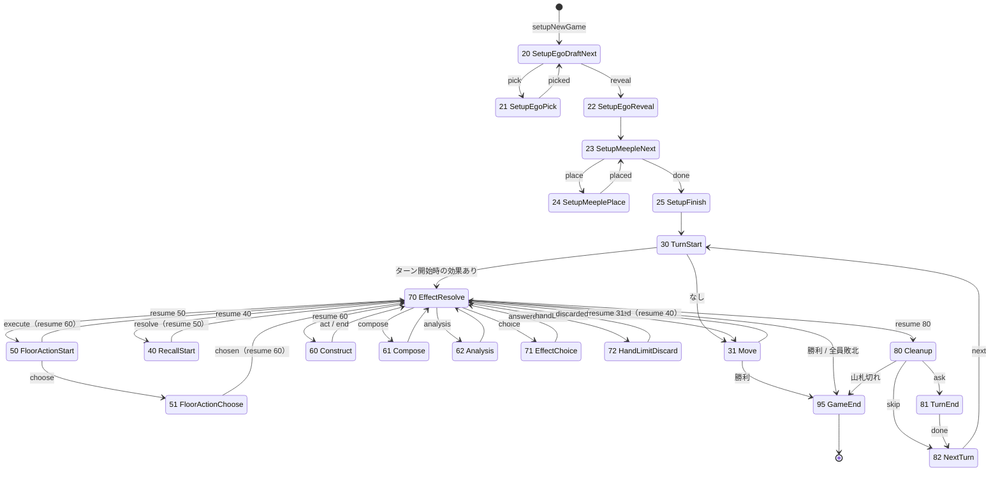
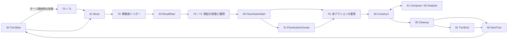

# 006: 状態遷移の設計

| 項目 | 内容 |
| --- | --- |
| ステータス | Approved |
| 対応タスク | T-006 |
| 作成日 | 2026-10-20 |
| 関連仕様書 | 001（ゲームルール）、002（カードデータ）、003（BGA プロジェクト構成・技術方針）。後続: 007（データモデル・通知）、008（カード効果）、009（UI・アセット） |

## 目的

001 のルール（セットアップ、初期自我の秘密ドラフト、手番の 5 フェイズ、想起の他プレイヤー発動、フリーアクション、手札上限、勝利と全員敗北）を、BGA の状態機械（状態クラス方式）に落とし込む。状態の ID・名前・種類・遷移・アクション・引数の公開範囲、割り込みの汎用パターン（効果解決の枠組み）、zombie、進行度、終局の表現を決め、007（データモデル）・008（カード効果）・実装者がこの文書を土台にできるようにする。

## スコープ

- 対象: 状態の一覧と遷移図、移動の確定方式、想起・床アクション・自己構成・精神分析・クリーンアップの状態への割り当て、フリーアクション（目標獲得、2 枚捨てて心光、トークン）を呼べる状態、手札上限の割り込み、即時勝利と全員敗北による終局、効果解決の枠組み（スタックと選択状態）、undo の方針、zombie、進行度、雛形の状態クラスの扱い、Studio で検証する点
- 対象外: DB スキーマ・通知の一覧・非公開情報の持ち方の詳細（→ 007）、個々のカード効果の処理（→ 008）、画面・クライアントの操作（→ 009）、CI・同期（→ 004・005）。この仕様書ではコードも設定ファイルも作らない

## 仕様

### 0. 記法と根拠

- 「001 §N」「002 §N」「003 §N」は各仕様書の節。「Q-NN」は [rule-questions.md](../development/rule-questions.md) の質問番号。
- **【確認】** は BGA 公式ドキュメントで確認した事実（URL を添える）。**【提案】** は本仕様書の提案。**【未確認】** は公式から判断できなかった事項で、§14「Studio で検証する点」に挙げる。**【姉妹】** は姉妹プロジェクトの実績。
- 調査日は 2026-10-20。公式ページは WebFetch（本文を要約して返すツール）で取得したため、要約を介した確認である。

| 略称 | URL |
| --- | --- |
| StateDir | <https://en.doc.boardgamearena.com/State_classes:_State_directory> |
| GamePhp | <https://en.doc.boardgamearena.com/Main_game_logic:_Game.php> |
| StatesInc | <https://en.doc.boardgamearena.com/Your_game_state_machine:_states.inc.php> |
| Zombie | <https://en.doc.boardgamearena.com/Zombie_Mode> |
| GameInfos | <https://en.doc.boardgamearena.com/Game_meta-information:_gameinfos.jsonc> |

### 1. BGA の仕組みの確認結果

| No. | 事実 | 出典 |
| --- | --- | --- |
| B1 | 状態クラスは `GameState` を継承し、コンストラクタに `id`・`type`（必須）と `name`・`description`・`descriptionMyTurn`・`transitions`・`updateGameProgression`・`initialPrivate`（任意）を渡す。ACTIVE_PLAYER / MULTIPLE_ACTIVE_PLAYER では `descriptionMyTurn` が必須。`type` は `ACTIVE_PLAYER` / `MULTIPLE_ACTIVE_PLAYER` / `PRIVATE` / `GAME` | StateDir |
| B2 | 状態 ID は一意の正の整数で、1 と 99 は予約。稼働中のゲームで ID を変えると壊れる | StateDir |
| B3 | `onEnteringState`・`act*`・`zombie` の戻り値に、状態クラス名・状態 ID（`int` 型で）・遷移名を返すと遷移する。遷移名を使うときは `transitions` の宣言が要る。クラス名・ID で返す場合は宣言のない状態へも遷移できる（ページに「未宣言の遷移名が使えるか」の記述はないが、クラス名・ID での遷移は記載がある）。戻り値で遷移するときは `nextState` を併用しない | StateDir |
| B4 | GAME 状態は手番プレイヤーを持たない自動処理用。ACTIVE_PLAYER 状態に入る前にアクティブプレイヤーを設定する必要があり、状態の途中では変えられない | StateDir |
| B5 | `changeActivePlayer($playerId)` は任意のプレイヤーをアクティブにする。**同じアクションの中で状態遷移を行う必要がある**（フロントに通知するため）。`activeNextPlayer()` は席順の次のプレイヤーへ | GamePhp |
| B6 | 非 GAME 状態には `zombie(int $playerId)` が必須。戻り値は `onEnteringState` と同様。ゲームを早期に終わらせない。レベル 0（何もせず進める）〜2 のいずれか | StateDir、Zombie |
| B7 | `getArgs` の戻り値は全員に公開される。本人だけに見せる値は `_private`（プレイヤー ID をキー）に入れる | StateDir |
| B8 | `updateGameProgression: true` の状態に入るたびに `getGameProgression()`（0〜100）が呼ばれる。少なくとも 1 つの状態に付ける。進行度は離脱時の ELO 計算と、2 人戦の非トーナメントでの投了条件（50% 以上）に使われる | StateDir、GamePhp |
| B9 | 最後の状態は 99 の代わりに `GameResult::individualRanking(...)` を返せる。`stGameEnd()` / `argGameEnd()` は `Game.php` でオーバーライドしない | StateDir、GamePhp |
| B10 | 全員が負ける場合の表し方は、準協力の例として「全員のスコアを 0 にする（全員が同点になる）」と書かれている。勝者と敗者だけを表示したいときは、勝者に最高点、他の全員に同じ低い点を与え、`gameinfos.jsonc` の `losers_not_ranked` を `true` にすると結果が「Winner / Loser」と表示される | GamePhp |
| B11 | `undoSavepoint()` は multiactive 状態、および次が multiactive の場合は使えず、保存点は 1 つだけ。`db_undo_support` が `true` でないと動かない | GamePhp |
| B12 | 通知はアクションの終わりにまとめて送られ、例外が起きると破棄される。`notify->all` の `_private` で本人だけの内容を 1 通知にまとめられる | GamePhp |
| B13 | `#[JsonParam(alphanum: false)]` は姉妹 MJ・PE の `act*` で使われている実績がある（ネストした配列の受け渡し） | 【姉妹】（姉妹 MJ・PE の `src/`） |

### 2. 設計の方針

1. **1 状態 1 クラス**。状態クラスは「入場時の準備」「表示用の引数」「プレイヤーの操作」「zombie」だけを書き、ルールの計算は `Flow/`・`Effects/` に委ねる（003 §4.2）。`getArgs` では DB を書かない。
2. **MULTIPLE_ACTIVE_PLAYER は使わない**。003 未確定事項 No.9（全カードの想起効果を確認し、同時選択が必要なものがあるか）の結論として、001・002 の全効果を確認した結果、**同時に決めなければならない選択は存在しない**。想起効果の選択（場札の獲得、交換など）は発動順に意味があり（場札の取り合い）、ルールも順序を定めている（001 §7）。秘密ドラフトも逆順に 1 人ずつ。よって全ての人間の入力は ACTIVE_PLAYER 状態で 1 人ずつ受ける（003 §5.2 案 A）。
3. **割り込みは「効果解決スタック」で統一する**（§7）。GAME 状態 `EffectResolve` がスタックを順に処理し、選択が要る所だけ `changeActivePlayer` で選択者を ACTIVE_PLAYER にした汎用選択状態 `EffectChoice` へ出て、答えたらまた `EffectResolve` へ戻る。想起の他プレイヤー発動、ターン開始時の効果、床アクションの各要素、精神分析ボーナス、起動効果のトリガーはすべてこの仕組みで扱う。
4. **自己構成・精神分析・移動は「計画をクライアントで作り、1 回の `act` で確定する」**（§5.1、§5.4）。支払い（手札を捨てる、自己構成済みカードを横向きにする、心光、トークン）の組み合わせはクライアントで組み立て、サーバーが全体を検証して 1 トランザクションで適用する。これにより「連続した部屋なら複数の鍵を同時使用とみなせる」「心光の X 回目」などの制約を、確定前に 1 か所で検証できる。
5. **ゲームの終了は割り込みで行う**。勝利・全員敗北が成立したら、どの状態からでも `GameEnd`（ID 95）へ ID（`int`）を返して遷移する（§9）。
6. **undo は使わない**（§12）。003 §5.1 のとおり。
7. 状態 ID は `Flow/StateId.php` の定数にまとめ、`transitions` の行き先は定数で書く（003 §4.2、姉妹の実績）。

### 3. 状態の一覧

#### 3.1 ID の割り当て

- 1 と 99 は予約（B2）。**雛形の 10（`PlayerTurn`）・90（`NextPlayer`）・98（`EndScore`）は使わない**（§13）。ID は全て 1〜99 に収め、10・90・98 を避ける（100 以上が使えるかは公式に記述がなく、姉妹 PE は未確認のまま使っている。ここでは確認の要らない範囲に収める。§14 V-3）。
- 10 番台ごとのブロックに分ける。ブロックの先頭がそのブロックの入口。後から状態を足しても他のブロックの ID が動かないようにする。

| ブロック | ID | 内容 |
| --- | --- | --- |
| セットアップ | 20〜25 | 初期自我の秘密ドラフト、ミープルの配置、手番への接続 |
| ターン開始・移動 | 30〜31 | ターン開始、移動 |
| 想起 | 40 | 想起フェイズの開始（発動の割り込みは 70 番台） |
| 床アクション | 50〜51 | 床アクションの準備と選択 |
| 自己構成フェイズ・自己構成・精神分析 | 60〜62 | 自己構成フェイズの窓、自己構成アクション、精神分析アクション |
| 効果解決と手札上限 | 70〜72 | 効果解決スタック、汎用の選択、手札上限の捨て札 |
| クリーンアップ・ターン終了 | 80〜82 | クリーンアップ、ターン終了の窓、次の手番へ |
| 終了 | 95 | 終局（スコア確定と `GameResult` の返却） |

状態は **21 個**（GAME 11、ACTIVE_PLAYER 10）。クラス名の名前空間は `Bga\Games\IRevolveThereforeIAm\States`（003 §4.1）。

#### 3.2 状態一覧

「公開 args」は `getArgs` の戻り値の公開部分、「private args」は `_private[プレイヤー ID]`（B7）。GAME 状態は `getArgs` と `zombie` を持たない。表の「→」は遷移名と行き先。`resume` は DB に保存した戻り先の状態 ID（§7.3）で、70 が `int` で返す（B3）。

| ID | クラス名 | 種類 | 概要 | 遷移 |
| --- | --- | --- | --- | --- |
| 20 | `SetupEgoDraftNext` | GAME | 初期自我のドラフト（001 §4 手順 13）。逆順（手番順の最後 → 1 番手）で次に選ぶ人を決め `changeActivePlayer`。全員選び終えたら 22 | `pick` → 21、`reveal` → 22 |
| 21 | `SetupEgoPick` | ACTIVE_PLAYER | 回ってきた山から初期自我を 1 枚秘密裏に選ぶ。公開 args: 選択者、山の残り枚数。private args: 候補カード ID。act: `actPickInitialEgo` | `picked` → 20 |
| 22 | `SetupEgoReveal` | GAME | 全員の選択を `notify->all` で一斉公開。最後に残った 1 枚はゲームから除外（Q-20） | `done` → 23 |
| 23 | `SetupMeepleNext` | GAME | ミープルの配置（手順 14）。逆順で次の人を決め `changeActivePlayer`。全員置いたら 25 | `place` → 24、`done` → 25 |
| 24 | `SetupMeeplePlace` | ACTIVE_PLAYER | まだミープルがいない四隅（レベル 2 の部屋）から 1 つ選ぶ。公開 args: 空いている四隅。act: `actPlaceMeeple` | `placed` → 23 |
| 25 | `SetupFinish` | GAME | 1 番手をターンプレイヤーにして `changeActivePlayer`。ターン番号、手番内カウンタを初期化 | `start` → 30 |
| 30 | `TurnStart` | GAME | 手番内カウンタ（入室部屋、獲得した心光、獲得した目標、精神分析の回数、このターンの割引など）を初期化。ターン開始時の効果（002 §6.4 の `TURN_START`、強化自我 E03〜E05、初期自我 I05 など）があればスタックに積む（§7）。ターンプレイヤーを `changeActivePlayer` で確認 | `effects` → 70（resume = 31）、`move` → 31 |
| 31 | `Move` | ACTIVE_PLAYER | 移動フェイズ。**経路全体と支払いをまとめて確定**（§5.1）。公開 args: ターンプレイヤー、現在位置、各部屋のレベルと錠前。private args: なし（手札はクライアントが持つ）。act: `actMove`、フリーアクション（§6） | `moved` → 70（resume = 40）。勝利が成立したら 95 |
| 40 | `RecallStart` | GAME | 想起フェイズ。ターンプレイヤーの部屋の想い出カードを表向きにして公開。部屋にいる全員の発動をターンプレイヤーから時計回りにスタックへ積み、続けて「ターンプレイヤーが部屋のカードを獲得」「手札上限の確認」を積む（§5.2） | `resolve` → 70（resume = 50） |
| 50 | `FloorActionStart` | GAME | 床アクションフェイズ。ターンプレイヤーの現在の部屋の床アクションと、想起で得た代替（`ALT_*`）から選択肢を作る。選ぶ余地がなければ自動で実行する（§5.3） | `choose` → 51、`execute` → 70（resume = 60） |
| 51 | `FloorActionChoose` | ACTIVE_PLAYER | 床アクションか代替かの選択（「/」の分岐を含む）。公開 args: 選択肢の一覧。act: `actChooseFloorAction`、フリーアクション | `chosen` → 70（resume = 60） |
| 60 | `Construct` | ACTIVE_PLAYER | 自己構成フェイズの窓。ここで自己構成アクション（フェイズの 1 回）、自己構成トークン、精神分析トークン、フリーアクションを任意の順に使い、`actEndConstruct` で終える（§5.5）。公開 args: フェイズの自己構成を使用済みか、使えるトークン数 | `act` → 70（resume = 60）、`end` → 70（resume = 80） |
| 61 | `Compose` | ACTIVE_PLAYER | 自己構成アクションの実行。コンテキスト（フェイズ・床・トークン・ボーナス・代替）は DB の frame に持つ（§5.5）。act: `actCompose`、`actComposeArchitect`（I03）、`actCancel`、フリーアクション | `done` → 70 |
| 62 | `Analysis` | ACTIVE_PLAYER | 精神分析アクションの実行。act: `actAnalyze`、`actCancel`、フリーアクション | `done` → 70 |
| 70 | `EffectResolve` | GAME | 効果解決スタックの処理（§7）。自動で済む効果はループ内で解決し、選択が要るところで `EffectChoice`、特別な状態（自己構成・精神分析・手札上限）が要るところで 61・62・72 へ。スタックが空になったら `resume` へ | `choice` → 71、`compose` → 61、`analysis` → 62、`handLimit` → 72。`resume` は ID を `int` で返す。終局は 95 |
| 71 | `EffectChoice` | ACTIVE_PLAYER | 汎用の選択（§7.4）。選択者は frame が持つ。公開 args: 選択の種類・選択者・出典カード。private args: 本人にだけ見せる候補。act: `actResolveChoice`、`actSkipChoice`、フリーアクション（選択者がターンプレイヤーのとき） | `answered` → 70 |
| 72 | `HandLimitDiscard` | ACTIVE_PLAYER | 手札上限（8 枚）を超えたプレイヤーが、超過分を捨てる（§8）。公開 args: 対象者と枚数。act: `actDiscardExcess`、フリーアクション（対象者がターンプレイヤーのとき） | `discarded` → 70 |
| 80 | `Cleanup` | GAME | クリーンアップ a〜d（001 §13）と山札切れの判定。O004 を獲得できる状況（§6.3）なら 81、そうでなければ 82 | `ask` → 81、`skip` → 82。山札切れなら 95 |
| 81 | `TurnEnd` | ACTIVE_PLAYER | ターン終了時の窓。**ターン終了時にだけ条件を満たせる目標（O004）を獲得するため**（§6.3）。O004 を獲得できる状況のときだけ入る。act: `actEndTurn`、フリーアクション | `done` → 82 |
| 82 | `NextTurn` | GAME | 「このターン」限りの効果と手番内カウンタを破棄し、`activeNextPlayer` で次のターンプレイヤーへ。`updateGameProgression: true` | `next` → 30 |
| 95 | `GameEnd` | GAME | 終局。勝者または全員敗北に応じてスコア・統計を確定し、`GameResult::individualRanking` を返す（B9、§9.3） | （ゲーム終了） |

- ターンプレイヤーの ID は DB（`GlobalValues`）に持つ。想起の割り込み中は `getActivePlayerId()` が他のプレイヤーになるため、ターンプレイヤーとして使わない（003 §5.2）。
- 70 は ID を `int` で返して `resume` や 95 へ遷移する（B3）。`transitions` に載せない遷移は、宣言のある遷移名と併用しても二重遷移にならない（`nextState` を使わない）。

### 4. 遷移図

#### 4.1 全体



70 `EffectResolve` がハブで、他の全ての状態は処理後に 70 へ戻る。図では「どの状態からでも 95 へ」を、勝利・全員敗北が起きうる主な箇所だけ描いている（§9。61・62・60・81 などからも `int` で 95 を返せる）。

#### 4.2 一手番の流れ（正常系）



### 5. 手番の各フェイズ

#### 5.1 移動フェイズ（31 `Move`）: 確定方式の比較と決定

001 §6 の移動は、部屋ごとに入室コストを払う操作を繰り返す。確定の単位を 2 案で比較した。

| 項目 | 案 A: 1 部屋ずつ確定 | **案 B: 経路全体をまとめて確定（採用）** |
| --- | --- | --- |
| 操作 | 「次の部屋へ（またはスキップして次へ）」と支払いを部屋ごとに送る。サーバーは 1 部屋ずつ適用して状態を返す | クライアントで経路と全部屋の支払いを組み立て、確認ボタンで `actMove` を 1 回送る。サーバーは全体を検証して 1 部屋ずつ順に適用する |
| 「複数鍵カードの分割禁止、連続した部屋なら同時使用」（001 §6-1 a） | 前の部屋で使った鍵の残りを「次の部屋に限り使える」状態として持ち越す必要があり、持ち越しの失効（間に別のカードで払う部屋を挟んだ時点）を状態に持つ | 経路全体の割り当てから「同じカードを使う部屋が、入室した部屋の列で連続している」ことを 1 か所で検証できる。持ち越し状態が要らない |
| 心光の逓増（1・2・3 個） | 部屋をまたぐカウンタが DB に要る | 1 回の検証の中で順に数えるだけ |
| 不可逆な確定 | 1 部屋ごとに確定するため、全体の費用を見てから取りやめることができない | クライアント側の計画なら、全体費用を見てやり直せる（確定前は何も変わらない） |
| 途中の効果 | 部屋ごとに効果を挟みやすい | 移動中に**選択を要する効果が無い**ため不要（下記） |
| 即時勝利（刹那の追憶） | 12 部屋目の入室時に自然に判定 | サーバーが順に適用するので、12 部屋目で止めて判定できる |
| 実装・UI の重さ | サーバーは単純。クライアントは単純 | クライアントの計画 UI が重い（009 の担当）。サーバーは検証関数が 1 つ |
| 手札の動き | 支払いの捨て札が部屋ごとに減る | 計画中の手札は仮想的に減る |

**決定: 案 B（経路全体をまとめて確定）**【提案】。決め手は次の 3 点。

1. 001 §6-1 の「連続した部屋なら同時使用」と「X 回目の心光」は経路全体の性質で、まとめて検証するほうが状態を持たずに済む。
2. 移動中に**プレイヤーの選択が要る効果が無い**ことを 001・002 の全効果で確認した。経路中に起きるのは、周遊ボーナス（自動）、M064〜M066（万能鍵を 1 つ得て、その入室の支払いに使う。自動）、M096（意志鍵を万能鍵として扱う。自動）、I07（初めて他の人格がいる部屋を通過したとき 1 枚引く。自動）、M059・M063（心光の逓増の軽減。自動）だけ。移動の終了時の効果（M061、M062、M067〜M069、I06）は経路の確定後に 70 で解決する（下記）。
3. 移動は全て公開情報（部屋の位置、裏面の錠前、自分の手札）で決まり、確定前に見るべき隠れた情報がない。クライアントで計画しても情報の漏れも不整合も起きない。

##### `actMove` の入力

`#[JsonParam(alphanum: false)]` で次を受ける（B13）。形は 007 で確定する。

```text
{
  "rooms": [4, 5, 7],                    // 入室する部屋の位置（1〜12）を順に。スキップした部屋は書かない
  "payments": [                          // rooms と同じ長さ。各部屋の錠前 1 個ごとの支払い
    [ {"src": "TABLEAU", "card": 31, "key": 0} ],
    [ {"src": "HAND", "card": 12, "key": 1}, {"src": "LIGHT"} ],
    [ {"src": "TOKEN"}, {"src": "EFFECT", "card": 64} ]
  ]
}
```

- `src` は `TABLEAU`（自己構成済みカードを横向きにする）、`HAND`（手札を捨てる）、`LIGHT`（心光）、`TOKEN`（万能移動鍵トークン）、`EFFECT`（カード効果が与える鍵。M064〜M066）。`key` はそのカードの `e1` / `e2` のどちらの鍵か。
- 経路の長さは 1 以上 24 以下（1 周を超える移動の規定がない。001 §6。刹那の追憶を満たせば途中で終わるので上限を設ける）。

##### サーバーの検証と適用

1. 経路の検証: 各入室は、現在位置の次の部屋か、次の部屋がレベル 2 のときのその次の部屋。スキップできるのは「現在いる部屋の次」がレベル 2 のときだけ（001 §6）。最低 1 部屋。
2. 錠前の数: レベル 1 の部屋は 1 個、レベル 2 の部屋は 2 個（同種）。錠前の種類は DB の部屋の裏面（公開情報）。
3. 支払いの検証: 鍵が錠前の種類に合う（万能鍵は何にでも合う）。1 つの鍵源（カードの 1 本の鍵）は 1 回だけ使う。同じカードを使う入室は、入室した部屋の列で連続している（間にスキップした部屋があっても連続とみなす。Q-07）。心光は経路の順で数えて 1・2・3 個目…と払う（M059・M063 の軽減を反映）。万能移動鍵トークンは表向きのもの。同じ手番の移動で使用済みにしたカードは、後の精神分析では使えない（001 §10-2）。
4. 適用: 部屋を 1 つずつ順に、支払いを確定し、ミープルを移動し、周遊ボーナス（入室・スキップのたびに。Q-26）を与え、入室済み部屋の集合に加える。**12 部屋に入室した時点で刹那の追憶が成立**し、残りの経路は適用せず 95 へ（Q-09）。
5. 経路の確定後、移動終了時のトリガー（M061、M062、M067〜M069、I06 など。002 §6.4）と、その順序の選択を 70 のスタックに積み、`resume = 40` で 70 へ。複数あるときのターンプレイヤーによる順序の選択は §7.5。

#### 5.2 想起フェイズ（40 `RecallStart` + 70 / 71）

001 §7、003 §5.2 案 A（順番に処理）を、効果解決スタックで実現する。

1. **40（GAME）**: ターンプレイヤーのいる部屋の想い出カードを表向きにして公開する（`notify->all` でカード番号を載せる。003 §5.4）。想起効果（002 §3.4 の 13 種）はこのカードの種類で決まる。
2. 発動者の列を作る: その部屋にいる全員を、ターンプレイヤーから時計回りの席順に並べる。ターンプレイヤーは常に含まれる。M062 の効果があれば、ターンプレイヤーの発動回数は 2（FAQ 行 12〜14）。
3. 次の frame を、発動順に実行されるようスタックに積む: 発動者ごとの `RECALL_ACTIVATION`（効果の種類と回数を持つ）、続けて `ACQUIRE_ROOM_CARD`（ターンプレイヤーが開始時の部屋のカードを手札に獲得。Q-04。想起で別の部屋に移動していても、獲得するのは開始時の部屋のカード。001 §7）、続けて `HAND_LIMIT_CHECK`（§8）。
4. 70 がスタックを処理する。`RECALL_ACTIVATION` は効果の種類で分かれる。

| 想起効果（002 §3.4） | 解決 | 発動者 |
| --- | --- | --- |
| `DRAW_1`、`LIGHT_1`、`NEXT_COMPOSE_DISCOUNT_1` | **自動**（70 の中で解決し、通知のみ） | 全員 |
| `OPEN_DRAW_1` | 場札から 1 枚を選ぶ（`EffectChoice`: `PICK_FIELD_CARD`）。場札が 0 枚なら無視（FAQ 行 6）。**発動順で場札の取り合いになる**ため順番に処理が必要 | 全員 |
| `DISCARD_FOR_LIGHT` | 手札から好きな枚数を選んで捨てる（0 枚可）。手札が 0 枚なら自動で飛ばす | 全員 |
| `SWAP_HAND_FIELD` | 手札と場札を好きな枚数入れ替える（0 枚可）。手札または場札が 0 枚なら飛ばす | 全員 |
| `SWAP_SAME_COST` | 自己構成済みの 1 枚と同じコストの手札の 1 枚を交換するか選ぶ。候補がなければ飛ばす | 全員 |
| `ALT_ANALYSIS`、`ALT_COMPOSE`、`ALT_*_DISCOUNT_1` | **選択なし**。「床アクションの代わりに行える」選択肢をターンプレイヤーの `floor_alternatives` に記録するだけ。選ぶのは床アクションフェイズ（FAQ 行 7、001 §7）。ターンプレイヤー以外は発動できない | ターンプレイヤーのみ |
| `MOVE_NEXT_LV1`、`MOVE_NEXT_LV2` | 移動するかどうかを選ぶ（`EffectChoice`: `CONFIRM_MOVE`）。移動する場合は、周遊ボーナスを得て（FAQ 行 8）、入室コストは払わず（Q-06）、場札を 1 枚獲得し（`PICK_FIELD_CARD`）、移動先を床アクションの部屋にする。**発動者はターンプレイヤーのみ**とする暫定案（ルール質問 R-2） | ターンプレイヤーのみ |

- 選択が実際に必要なプレイヤーだけが `EffectChoice` に入る（003 §5.2）。自動で済む効果は 71 を経由しない。
- 選択が要る人には 70 が `changeActivePlayer` し、71 へ遷移する。71 は選択者が答えると 70 に戻る。ターンプレイヤー以外の離脱（zombie）は「スキップ」として扱い、次の人へ進む（003 エッジケース）。
- 想起で別の部屋に移動した場合、移動先の部屋のカードは表向きにしない（FAQ 行 9）。
- 想起の起動効果で、想起フェイズ中に発動できるもの（M071 は自己構成時なのでここでは該当しない）の扱いは 008。
- 発動者の列に入るのは、想起フェイズの開始時にその部屋にいたプレイヤー。想起効果で移動した後の位置は関係しない。

#### 5.3 床アクションフェイズ（50 + 51 + 70）

001 §3・§8、FAQ 行 8・9・12。

- 50 は、ターンプレイヤーの**現在の**部屋（想起で移動していれば移動先。FAQ 行 8）の床アクションを調べる。選択肢は次の 2 種類を合わせた一覧。
  1. 床アクション自体。「/」の分岐があるもの（APHRODITE: 場札 2 枚獲得 / 心光 2、HEPHAESTUS: 自己構成（エネルギー -1）/ 山札から 2 枚引く）は分岐ごとに別の選択肢にする。
  2. 想起で記録された代替（`floor_alternatives`）。同じ種類（精神分析 / 自己構成）が複数あるときは、割引が最大のものだけを選択肢に残す（割引の小さいほうを選ぶ理由がない。FAQ 行 12 により、代替を 2 回使っても変わらない）【提案】。
- 選択肢が 1 つだけで、行わない選択もできないとき（例: DEMETER の山札 3 枚）は、50 が選択を求めずにそのまま実行する（`execute`）。それ以外は 51 で選ぶ。
- 床アクションを行わない選択は「自己構成・精神分析の床アクション」だけに許される（Q-11）。これは選択肢の段階では扱わず、実行する 61・62 の `actCancel`（行わない）として表す。
- 実行は frame を積むことで行う。要素は左から右に解決する（「→」。Q-11）。

| 床 | frame の列（001 §3 の表より） |
| --- | --- |
| F1 DEMETER | `DRAW 3` |
| F2 HERMES、F6 DIONYSUS | `ANALYZE`（任意） |
| F3 ATHENA、F8 APOLLO | `DRAW 3` → `DISCARD 1`（`EffectChoice`: `PICK_DISCARD`、必須） |
| F4 POSEIDON | `SET_TURN_DISCOUNT 1`（このターンの自己構成エネルギー -1）→ `COMPOSE`（任意） |
| F5 ARES、F11 ARTEMIS | `GAIN_FIELD 1` → `LIGHT 1` |
| F7 HESTIA | `GAIN_FIELD 1` → `DRAW 1` → `LIGHT 1` |
| F9 APHRODITE | 分岐 A: `GAIN_FIELD 2` / 分岐 B: `LIGHT 2` |
| F10 HADES | `ANALYZE`（任意）→ `LIGHT 1` |
| F12 HEPHAESTUS | 分岐 A: `COMPOSE`（任意、エネルギー -1）/ 分岐 B: `DRAW 2` |

- 床アクションの要素の frame には `origin = FLOOR` を付ける。M085〜M087（床の効果で心光・山札・場札を獲得するとき追加）が反応するための印（002 §6.4、FAQ 行 27）。
- 床アクション全体（選択した選択肢の全要素）を 1 つの「ユニット」として扱い、完了後に手札上限を確認する（§8、Q-32）。
- 代替の自己構成・精神分析も床アクション扱い（FAQ 行 12）。frame には `origin = FLOOR` を付け、キャンセルされた場合は 51 に戻って別の選択肢を選べる（`cancel_to = 51`。何も消費していないため）。

#### 5.4 精神分析アクション（62 `Analysis`）

- 呼び出し元は、床アクション（HERMES・DIONYSUS・HADES、代替）と精神分析トークン（001 §10-1）。いずれも 70 が `ANALYZE` frame を処理して 62 に入る。コンテキスト（`FLOOR` / `TOKEN`、コスト割引、キャンセル可否）は frame が持つ。
- 62 の入力: `actAnalyze(destination, payment)`。`destination` は進む先の精神カード（次の階層が 2 枚あるときはどちらか。001 §10-1）。`payment` は移動と同じ形式（`TABLEAU` / `HAND` / `LIGHT`。万能移動鍵トークンは不可）。
- 支払いはクライアントで計画し、サーバーが全体を検証して 1 回で確定する。自己構成済みカードの複数の鍵は同時に使える。同じ手番に移動で使用済みにしたカードは使えない（001 §10-2）。心光の X 回目はこのアクションの中で数える。
- `actCancel`: 何も消費せずに戻る。精神分析トークンから入ったときは、トークンはまだ消費されていない（空撃ちの防止。FAQ 行 5。Q-28）。コストを払えない状況ではトークンの「使う」ボタン自体を出さない（`canAnalyze` を args で計算）。
- 確定後、70 に積むもの: 到着した精神カード上の心光の獲得（`origin = ANALYSIS`。FAQ 行 11・27）、ボーナス（第一: 山札 1 枚、第二: レベル 1 の自由自己構成、第三: 強化自我の獲得、第四: 任意レベルの自由自己構成、第五: 心理の極致）、トリガーされた起動効果（M058、M079〜M081 など）と I02。精神分析を実行した回数（O006）を数える。第五階層への到達は 95 へ（§9）。
- 第三階層の強化自我は、`EffectChoice` の `PICK_ENHANCED_EGO`。**候補（残りの山の全カード）は private args にだけ入れる**（003 §5.3。Q-08）。選んだカードは公開する。

#### 5.5 自己構成フェイズ（60 `Construct`）と自己構成アクション（61 `Compose`）

##### 60 `Construct` の構成

001 §11-1 は、自己構成トークン・精神分析トークンを「自己構成フェイズの前後」に使うとする。**前後を別の状態に分けず、1 つの窓（60）にまとめる**【提案】。

- 理由: 使える物は「自己構成フェイズの自己構成アクション 1 回」と「トークン 0 回以上」であり、これらを床アクションの終了後からクリーンアップの開始前までの間に、どの順序で使っても結果は同じになる。トークンは前後どちらでも使え、フェイズの自己構成も省略できるので、前後を区別する意味がない（心光の行使のカウントはアクションごとに別。001 §9-2）。FAQ 行 14（トークンで自己構成したカードの床代替の想起効果は使えない）も、床アクションフェイズが終わっていれば成立する。
- 60 の act: `actStartCompose`（フェイズの自己構成アクション。1 回だけ。使用済みフラグ）、`actUseComposeToken`（保有数が 1 以上のとき）、`actUseAnalysisToken`（同上で、精神分析できるとき）、`actEndConstruct`、フリーアクション（§6）。それぞれ frame を積んで 70 へ出て、終わったら 60 に戻る（`resume = 60`）。
- `actEndConstruct` は、手札上限の確認を積んで `resume = 80` で 70 へ（001 §12 「クリーンアップフェイズの前に 8 枚以下」。Q-30）。
- ターン開始時と移動・想起・床アクションの間には、トークンは使えない（001 §5-1。使える状態は 60 だけ）。

##### 61 `Compose`

- コンテキスト（frame が持つ）: `PHASE`（自己構成フェイズ）/ `TOKEN` / `FLOOR`（床・代替。割引つき）/ `BONUS_LV1`（第二階層ボーナス。エネルギー 0、レベル 1 のみ）/ `BONUS_ANY`（第四階層ボーナス。エネルギー 0）/ `EFFECT`（M088・M089 など、008 で追加）。`optional`（行わない選択ができるか）、`cancel_to`。
- 入力: `actCompose(cardId, payment)`。`payment` はエネルギーの支払い（手札を捨てる: レベル分、心光の行使: 1・3・6 個。001 §9-2）と、I08 の追加支払いなど。割引（POSEIDON、M060、M068、E01、M095 など）はサーバーが frame の文脈と DB の常時効果から計算して検証する。エネルギーは 0 未満にならない。過払いは可（Q-22）。
- `actComposeArchitect(tableauCardId, newCardId)`: I03（建築家）の「自己構成する代わりに行ってもよい」代替。同じ状態の別アクションとして受ける。
- 確定後、70 に積むもの: 即時効果（`INSTANT`）、起動効果のトリガー（M073〜M078、I01 など）、M071（自己構成したカードの想起効果の使用）。**自己構成スコアの更新と 20 点の判定**（§9）。

#### 5.6 クリーンアップ（80 `Cleanup`）とターン終了

GAME 状態の 80 で a〜d（001 §13）を順に行う。a: 自己構成済みカードを縦に戻す。b: 万能移動鍵トークンを表に戻す。c: 想い出カードのない部屋に補充（レベル 1 の部屋はレベル 1 の山札、レベル 2 の部屋はレベル 2 の山札から。裏向き）。d: 場札を 6 枚まで補充。

- c・d で山札が足りなければ、補充できるだけ補充して**全員敗北**（Q-05・Q-24）。80 から 95 へ直行する。
- 80 の最後に、O004 を獲得できる状況かを調べる（§6.3）。**そうなら** 81 `TurnEnd`（O004 の「ターン終了時」を判定できる窓。Q-30）に入り、そうでなければ 82 へ直行する。81 は目標の獲得と心光への変換のフリーアクション、`actEndTurn` だけを持つ。
- クリーンアップ後に手札が 8 枚を超えることはない（60 の終了時に確認済みで、クリーンアップは手札を増やさない）。
- 82 は「このターン」限りの効果（FAQ 行 10）と手番内カウンタを破棄し、`activeNextPlayer` で次のターンプレイヤーを決めて 30 へ。

### 6. フリーアクション

#### 6.1 対象

| フリーアクション | act | 条件 |
| --- | --- | --- |
| 目標カードの獲得 | `actClaimObjective(objectiveId)` | 1 ターンに 1 枚まで。場に残っている目標。条件はサーバーが評価（001 §11-2、Q-12）。ターンプレイヤーのみ |
| 想い出カード 2 枚分を捨てて心光を獲得 | `actDiscardForLight(cardIds)` | レベル 1 は 1 枚分、レベル 2 は 2 枚分で数え、合計 W に対し心光 `floor(W / 2)` を獲得（端数は失われる。Q-22 に準ずる）。回数無制限。ターンプレイヤーのみ（Q-03） |
| 自己構成トークンの使用 | 60 の `actUseComposeToken` | §5.5 |
| 精神分析トークンの使用 | 60 の `actUseAnalysisToken` | §5.5 |

#### 6.2 呼べる状態

フリーアクションの 2 つ（目標獲得、心光への変換）は、**アクティブプレイヤーがターンプレイヤーである状態**に限って呼べる。BGA ではアクティブでないプレイヤーは `act` を呼べないため、他プレイヤーの想起発動中の 71 では、ターンプレイヤーは呼べない【提案】。ターンプレイヤーはその割り込みの後に呼べるので、損失はない（目標は条件を満たしている間いつでも獲得でき、心光への変換は手番中のいつでも可能）。

| 状態 | 目標獲得 | 心光への変換 | トークン | 備考 |
| --- | --- | --- | --- | --- |
| 31 `Move` | 可 | 可 | 不可 | 心光を先に作ってから支払いを組み立てる（001 §11-3「支払いの途中でも」） |
| 51 `FloorActionChoose` | 可 | 可 | 不可 | |
| 60 `Construct` | 可 | 可 | 可 | |
| 61 `Compose`、62 `Analysis` | 可 | 可 | 不可 | 支払い計画中に心光へ変換できる |
| 71 `EffectChoice`（選択者 = ターンプレイヤー） | 可 | 可 | 不可 | |
| 72 `HandLimitDiscard`（対象 = ターンプレイヤー） | 可 | 可 | 不可 | 超過分を心光に変えて減らせる |
| 81 `TurnEnd` | 可 | 可 | 不可 | |
| 71（選択者 ≠ ターンプレイヤー）、72（対象 ≠ ターンプレイヤー） | 不可 | 不可 | 不可 | |
| セットアップの 21・24、GAME 状態 | 不可 | 不可 | 不可 | |

- 実装は共通のトレイト（`FreeActions`）にし、上の状態だけが使う。act は `PossibleAction` で、ターンプレイヤーでなければ `UserException`。
- 目標獲得と心光への変換の後には、必ず勝利判定（断片の結集）と手札上限の確認を行う。心光への変換で手札が減るので、72 の中でも使える。

#### 6.3 O004 の「ターン終了時」

O004 の条件は「ターン終了時（クリーンアップ後、手札上限の調整後）の手札が 6 枚以上」（Q-30）。この条件を判定できるのは 80 の後だけなので、80 の最後に、(a) O004 が場に残っている、(b) ターンプレイヤーがこのターンにまだ目標を獲得していない、(c) 手札が 6 枚以上、の全てを満たすときだけ 81 に入る。他の目標は 60 までに獲得できるので、81 の対象は O004 だけである。自動では獲得しない（1 ターン 1 枚の制約のなかで、60 までに別の目標を取るか O004 を取るかをプレイヤーが選べるようにするため）。

### 7. 効果解決スタックと汎用の選択

008 が詳細を決める。ここでは枠組みだけを決める【提案】。

#### 7.1 frame

効果解決スタックは、frame の列を DB に持つ（007 で保存形式を決める）。

| 項目 | 内容 |
| --- | --- |
| `id`、`parent_id` | frame の ID と親 |
| `kind` | frame の種類（下表） |
| `owner` | 効果の持ち主（選択者）。常にプレイヤー ID |
| `source` | 出典（カード ID、床 ID、精神カード ID など） |
| `params` | 種類ごとのパラメータ（JSON） |
| `unit` | これを根とする 1 つのアクション・効果の解決が終わったら、手札上限を確認する単位か（§8） |
| `cancel_to` | `actCancel` されたときの戻り先（なければその frame を捨てる） |
| `origin` | `FLOOR` / `ANALYSIS` / `RECALL` / `TRIGGER` など。M085〜M087 などの反応条件に使う |

| frame の `kind` | 内容 |
| --- | --- |
| `TURN_START_EFFECT` | ターン開始時の効果の 1 つ |
| `RECALL_ACTIVATION` | 想起効果の発動（§5.2） |
| `ACQUIRE_ROOM_CARD` | ターンプレイヤーが開始時の部屋のカードを手札に獲得 |
| `MOVE_END_TRIGGER` | 移動終了時の起動効果 |
| `DRAW`、`GAIN_FIELD`、`LIGHT`、`DISCARD`、`SET_TURN_DISCOUNT` | 床アクションなどの基本要素 |
| `COMPOSE`、`ANALYZE` | 61・62 を呼ぶ |
| `TRIGGERED` | イベント（自己構成した、階層を上げた、心光を獲得した、など）で発動した起動・常時効果 |
| `ORDER_EFFECTS` | 同時にトリガーされた複数の効果の解決順をターンプレイヤー（または持ち主）が選ぶ（§7.5） |
| `HAND_LIMIT_CHECK` | 手札上限の確認（§8） |
| `END_CHECK` | 勝利・全員敗北の判定（§9） |

#### 7.2 70 `EffectResolve` のアルゴリズム

```text
function stEffectResolve():
    loop:
        if 勝利または全員敗北が成立 → return GameEnd（95）
        frame = スタックの先頭
        if スタックが空:
            ターンプレイヤーを changeActivePlayer
            return resume（int の状態 ID）
        switch frame.kind:
            自動で解決できる種類（DRAW、LIGHT、自動の想起効果 など）:
                解決して通知を積む。frame を捨てる。新しいトリガーがあれば frame を積む
                continue
            選択が要る種類:
                pending_choice を作る（frame を WAITING にする）
                changeActivePlayer(frame.owner)
                return 71（EffectChoice）
            COMPOSE / ANALYZE:
                changeActivePlayer(frame.owner)
                return 61 / 62
            HAND_LIMIT_CHECK:
                超過したプレイヤーがいれば、その人を changeActivePlayer して 72
                なければ frame を捨てて continue
```

- 70 は**内部のループで**連続して解決する（状態を連鎖させない）。再帰的な GAME 状態の連鎖には上限がありうるため（姉妹の U6、§14 V-6）。ループの安全弁として 1 回の入場で処理する frame の数に上限（例: 500）を置き、超えたら例外にする【提案】。
- `changeActivePlayer` は、状態遷移と同じ処理の中で呼ぶ（B5）。

#### 7.3 戻り先（`resume`）

- 70 を呼ぶ側が、スタックを積むときに `resume`（状態 ID の整数）を DB に保存する。スタックが空になったら 70 が `int` でその状態へ遷移する（B3）。
- 70 の中に別の 70 が入れ子になることはない（効果の連鎖は同じスタックに積まれる）。そのため、`resume` は 1 つの値でよい。ただし 61・62 から呼ばれる frame（自由自己構成など）が積まれても、`resume` は変わらない。
- 再読み込み・再接続では、DB のスタックと `resume` から、現在の状態（71 など）を復元する。選択者の候補は `getArgs` が DB から再構成する。

#### 7.4 汎用の選択（71 `EffectChoice`）

選択の種類（`choice_kind`）は 008 で完成させる。主なものを挙げる。

| `choice_kind` | 内容 | private args |
| --- | --- | --- |
| `ORDER_EFFECTS` | 同時にトリガーされた効果の解決順（次に解決するものを選ぶ）。ターン開始時の効果もこれ | なし（効果は公開） |
| `CONFIRM_USE` | 「してもよい」効果を使うか。使うを選ぶと frame の内容へ進む | なし |
| `PICK_FIELD_CARD` | 場札から 1 枚（以上）を獲得 | なし（場札は公開） |
| `PICK_DISCARD` | 手札から指定枚数を捨てる（ATHENA・APOLLO など。必須） | 手札はクライアントが持つ |
| `SELECT_DISCARD_FOR_LIGHT`、`SELECT_SWAP_HAND_FIELD`、`SELECT_SWAP_SAME_COST` | 想起の交換・変換 | なし |
| `CONFIRM_MOVE` | 想起効果で移動するか | なし |
| `SWAP_ROOM_CARDS`、`SWAP_ROOM_FLOORS`、`WARP_ROOM`、`ENTREPRENEUR_SWAP` | ターン開始時の入れ替え・ワープ（M052〜M057、M072、I05） | I05 の手札のカード |
| `PICK_ENHANCED_EGO` | 第三階層の強化自我の選択 | 候補（残りの山の全カード）。本人にだけ見せる |

- 71 の公開 args: `choice_kind`、選択者、出典（カード ID）、公開できる候補。非公開の候補は `_private[選択者]`（B7）。
- 答え方は `actResolveChoice(payload)` と `actSkipChoice()`。`payload` は種類ごとの `#[JsonParam]`。スキップが許されない種類（必須の捨て札など）では `actSkipChoice` を受けない。
- 71 は選択者を 1 人だけアクティブにする。選択者が複数いる場面は、スタックの順に 1 人ずつ（§2 の方針 2）。
- **1 人が複数の選択を持てる**ように、選択はスロットの上書きではなく frame として積む（姉妹 MJ #41 の教訓。003 §5.2）。

#### 7.5 同時にトリガーされた効果の順序

- 同じイベントで同じ持ち主の効果が 2 つ以上トリガーされたら（FAQ 行 24・26）、`ORDER_EFFECTS` の frame を積む。持ち主が「次に解決するもの」を 1 つずつ選ぶ（Q-29）。1 つだけなら選択は要らない。順序が結果に影響しない場合（全て自動で、互いに干渉しない）は、70 が固定順で解決する【提案】。
- ターン開始時の効果は、ターンプレイヤーが「次に解決するもの」を選ぶ（Q-29）。選んだ効果が「してもよい」の効果なら `CONFIRM_USE` で使う・使わないを選ぶ。1 つだけで必須の効果（E03〜E05 など）は選択を挟まずに自動で解決する。
- 異なる持ち主の効果がトリガーされた場合は、ターンプレイヤーから時計回りに、持ち主ごとにまとめて解決する（001 §7 の発動順に準ずる）【提案】。

### 8. 手札上限の割り込み（72 `HandLimitDiscard`）

001 §12、Q-32。

- 手札の上限は 8 枚。獲得により一時的に超えるのは許され、**1 つのアクション・効果の解決が終わったとき**、次に進む前に捨てる。
- 「1 つのアクション・効果」の単位は frame の `unit` で表す。次の単位が `unit = true`: ターン開始時の効果の 1 つ、移動フェイズ全体（移動終了時の効果を含む）、想起の発動者ごとの 1 回、`ACQUIRE_ROOM_CARD`、床アクション全体（選んだ選択肢の全要素）、自己構成アクション 1 回（トリガーされた効果を含む）、精神分析アクション 1 回（ボーナスとトリガーを含む）。
- 単位が終わった時点で 70 が `HAND_LIMIT_CHECK` を処理し、手札が 8 枚を超えたプレイヤーがいれば（ターンプレイヤーを先に、続いて席順）、そのプレイヤーを `changeActivePlayer` して 72 に入る。
- 72 の act は `actDiscardExcess(cardIds)`。捨てる枚数は超過枚数ちょうど。捨てるカードは自由に選べる。捨札は捨てたカードのレベルの捨札（Q-23）。
- ターンプレイヤーの対象のときは、フリーアクション（心光への変換）で超過分を減らせる（§6.2）。減らして 8 枚以下になれば `actDiscardExcess` は不要になり、自動で 70 に戻る。
- 60 の `actEndConstruct` の後に、最終の `HAND_LIMIT_CHECK` を行う（クリーンアップ前に 8 枚以下。Q-30）。
- 移動中の効果（I07 の 1 枚ドロー）で上限を超えた場合は、移動フェイズ全体の終了後に確認する【暫定。ルール質問 R-4】。

### 9. 勝利・全員敗北と終局

#### 9.1 判定の位置

勝利判定 `WinChecker::check()` と山札切れ判定は `Flow/` の純粋なクラスで行い、**状態遷移の前に呼ぶ**。成立したら該当の状態は `GameEnd`（ID 95）を `int` で返す（B3）。

| 条件 | 判定する場所 |
| --- | --- |
| 刹那の追憶（12 部屋に入室） | 31 の `actMove` の適用中、12 部屋目の入室の直後（Q-09）。想起効果による移動（`CONFIRM_MOVE`）も入室に数えるので、そこでも判定する |
| 断片の結集（自己構成スコア 20 以上） | 自己構成スコアが変わりうる全ての箇所の直後: 61 の確定、`actClaimObjective`、`SWAP_SAME_COST`（想起）、I03 の代替、I08 の追加支払いなど。70 は 1 つの frame を解決するたびに呼ぶ。目標カードの得点は状態で変わるので、状態を変えるたびに全プレイヤーを評価する（Q-09） |
| 心理の極致（第五階層に到達） | 62 の `actAnalyze` の確定直後（第五階層のボーナス）。M088 の効果では第五階層に上げられないため、ここだけ |
| 全員敗北（山札切れ） | 山札を引く・補充する処理が「足りない」と判定した瞬間にフラグを立て、**そのフレーム（またはアクション）の終了時**に判定する。引けるだけ引いてから終わる（Q-05） |

- 同時成立: 勝利と山札切れが同時なら**勝利を優先**（Q-05）。判定は 1 つの frame（またはアクション）の終わりにまとめて、勝利 → 全員敗北の順に調べる。
- 複数のプレイヤーが同時に勝利条件を満たした場合は、001 に規定がない。暫定案は「その解決を行っているプレイヤー（アクティブなプレイヤー）を先頭に、ターンプレイヤーから時計回りの順で最初に満たした 1 人を勝者とする」（ルール質問 R-3）。
- 勝利判定は 70 のループの先頭でも毎回呼ぶ（割り込みの途中でも終了できる）。

#### 9.2 終局後の扱い

- 勝者が決まったら、手番の残りのフェイズは行わない（001 §14-1）。スタックに残った frame は破棄する。
- 95 は、`end_reason`（`FRAGMENTS` / `INSTANT_MEMORY` / `APEX_OF_PSYCHE` / `DECK_OUT`）と勝者を DB から読んで終局処理を行う。

#### 9.3 スコアの表現（001 §15、003 エッジケース）

- ゲーム中の `player_score` は、現在の自己構成スコア（想い出カードのスコア + 目標カードの得点）を表示する。
- **勝者がいる場合**: 終局時に勝者の `player_score` を 1、他を 0 にする。`individualRanking` で勝者が 1 位、他は同率 2 位（001 §15）。`gameinfos.jsonc` の `losers_not_ranked` を `true` にして、結果表示を「Winner / Loser」にする候補（B10）。現在は姉妹と同じ `false` だが、`true` にしてよいかは 009 で表示を確認して決める【提案】。
- **全員敗北の場合**: 全員の `player_score` を 0 にして同率にする（B10。Q-25）。ログと終了時の通知に「想い出の山札が切れたため全員敗北」と表示する。この場合に「Winner」表示が出てしまうなら、`losers_not_ranked` を `false` に戻すか `GameResult` の他の種類を検討する（§14 V-8）。
- 自己構成スコア、精神階層、入室回数などは統計として保存する（統計の定義は 007）。

### 10. zombie と時間切れ

方針（B6）: ゲームを止めず、早期に終わらせず、失敗リスクのない行動を取る。ランダムは使わず決定的にする（再現できるように）。zombie の処理は渡された `$playerId` を使い、`getCurrentPlayerId()` を使わない。GAME 状態は zombie を持たない。

| 状態 | zombie の動作 | 理由 |
| --- | --- | --- |
| 21 `SetupEgoPick` | 候補の先頭（カード ID の昇順）を選ぶ | 非公開の選択に偏りを持ち込まない |
| 24 `SetupMeeplePlace` | 空いている四隅のうち位置番号が最小のものに置く | 決定的 |
| 31 `Move` | 次の部屋（レベル 2 でもスキップしない）まで 1 部屋だけ、**万能移動鍵トークン → 自己構成済みカードの鍵 → 心光**の順で払えるなら移動する（手札は捨てない）。払えなければ次の次の部屋を試し、それも払えなければ移動しない（ルール質問 R-1 の暫定案どおりに進む） | 刹那の追憶にならない。手札を失わない |
| 51 `FloorActionChoose` | 床アクション自体（代替ではないもの、分岐は先頭）を選ぶ | 無難 |
| 60 `Construct` | 何も使わずに `actEndConstruct` | トークンや自己構成をしない |
| 61 `Compose`、62 `Analysis` | `actCancel`（行わない）。キャンセルできない文脈（ボーナスの自由自己構成で `optional = false` のもの）はない | 無難 |
| 71 `EffectChoice` | スキップ可の種類はスキップ。必須の選択は種類ごとの既定（`PICK_DISCARD`: レベル 1 を優先して手札の後ろから、`PICK_FIELD_CARD`: 場札の先頭、`PICK_ENHANCED_EGO`: カード ID 最小） | 必須の選択でも進める |
| 72 `HandLimitDiscard` | 超過枚数分、レベル 1 を優先して手札の後ろから捨てる | 決定的 |
| 81 `TurnEnd` | `actEndTurn` | 目標を獲得しない |

- ターンプレイヤーが zombie になった後の手番は、30 で通常どおり始め、上の動作で進む。
- 手番に関わらず、離脱したプレイヤーの想起効果の発動（`RECALL_ACTIVATION`）は、自動で済む効果は通常どおり解決し、選択が要る効果はスキップする。
- zombie でもクリーンアップや終局処理は通常どおり行う。全員が zombie になったテーブルの扱いは BGA の標準に任せる（003 §5.5）。

### 11. 進行度（`getGameProgression`）

`updateGameProgression: true` を **82 `NextTurn`** に付ける（手番ごとに更新。B8）。次の式で 0〜99 を返し、終局後はフレームワークが 100 として扱う【提案】。

```text
level_progress = max_p (精神階層_p) / 5                           # 第五階層に到達すると終局するので、実際は 0〜0.8
score_progress = max_p min(自己構成スコア_p, 20) / 20
deck1_progress = 1 - (レベル 1 の山札の残り) / (セットアップ終了時のレベル 1 の山札)
deck2_progress = 1 - (レベル 2 の山札の残り) / (セットアップ終了時のレベル 2 の山札)
raw = max(level_progress, score_progress, deck1_progress, deck2_progress)
progress = max(min(99, floor(100 * raw)), progress_high_water)
progress_high_water = progress                                     # 永続データ。単調増加にする
```

- 理由: 勝利条件への近さ（精神トラック、自己構成スコア）と、山札切れ（全員敗北）への近さの最大値で近似する。刹那の追憶は 1 ターンで決まるので指標にしない。
- 単調増加にする: 目標カードの X の変動で自己構成スコアが下がっても、離脱時の ELO 計算で進行度が戻らないようにする。
- 式は `Flow/` の純粋な関数にして PHPUnit で検査する（003 §4.2）。係数は実プレイの統計が取れたら調整する（2 人戦の投了条件 50% が実感に合うか。B8）。

### 12. undo の方針

- **undo は使わない**（`db_undo_support: false`。003 §5.1、B11）。理由は、(a) 手札のドローや強化自我の秘密の確認などの隠れた情報があり、undo で漏れうる、(b) 保存点は 1 つだけで、ACTIVE_PLAYER の連鎖（割り込み）をまたげない、(c) 割り込みの途中でアクティブプレイヤーが他のプレイヤーに移る。
- 代わりに、取り消せない操作の前に**クライアントで計画を完結させ、確認してから送る**（§5.1、§5.4、§5.5）。サーバーに送る前の計画は何度でもやり直せる。
- サーバー側で何も消費していない時点では `actCancel` で戻れる（61・62 のキャンセル、トークンの空撃ち防止）。

### 13. 雛形の状態クラスの扱い

Studio の初期ファイルの状態クラスは `PlayerTurn`（10）、`NextPlayer`（90）、`EndScore`（98）。003 §3 のとおり、同名で上書きしない状態クラスは Studio に残って ID が衝突しうる。

| 雛形 | 扱い | 理由 |
| --- | --- | --- |
| `PlayerTurn`（10） | **使わない**。005 の削除リストに載せる | 本ゲームの手番は 31・40・50・60 に分かれ、1 つの `PlayerTurn` に当たるものがない |
| `NextPlayer`（90） | **使わない**。005 の削除リストに載せる | 役割は 82 `NextTurn` が担う。名前と ID を揃えると、雛形の `NextPlayer` と意味が異なって混乱する |
| `EndScore`（98） | **使わない**。005 の削除リストに載せる | 95 `GameEnd` が `GameResult` を返す（B9）。98 を終局の状態に使うと雛形と同じ ID になるため避ける |

- 本仕様書の状態は 10・90・98 を使わないので、雛形のクラスが残っても ID の衝突は起きないが、`PlayerTurn` などが Studio に残ると未使用の状態として BGA の状態機械に載るため削除する。削除の方法（同期でどう消すか）は 005 で決める。

### 14. Studio で検証する点

実装の最初の PR で Studio 上で検証する。だめだった場合の代替案を併記する。

| No. | 事項 | 代替案 |
| --- | --- | --- |
| V-1 | `act*` や `onEnteringState` が、宣言していない状態への ID（`int`）を返して遷移できるか（B3 の記述は「クラス名・ID で遷移できる」。70 の `resume` と 95 への遷移に使う） | 70 の `transitions` に戻り先ごとの遷移名（`toResume31`、`toResume40`、`toResume50`、`toResume60`、`toResume80`、`toGameEnd`）を宣言し、`resume` の値に対応する遷移名を返す。他の状態は 95 への遷移名を宣言する。状態の数・クラス・戻り先の保持は変わらない |
| V-2 | GAME 状態から `changeActivePlayer` した上で ACTIVE_PLAYER 状態へ遷移できるか（B4・B5 の記述は「同じアクションの中で遷移する」。70 → 71・61・62・72 に使う） | 遷移先の状態の `onEnteringState` で行う（状態に入る前の設定が必要なら、70 を直前の GAME 状態に分ける） |
| V-3 | 状態 ID が 100 以上でも動くか（公式は「正の整数」とのみ記述） | 本書の ID はすべて 99 以下なので影響しない |
| V-4 | `getArgs` の `_private` が 21（初期自我の候補）・71（強化自我の候補）で観戦者に漏れないか、リロードで復元されるか | 候補を `getArgs` に入れず、`notify->player` で送って `getAllDatas` の本人分で復元する |
| V-5 | `#[JsonParam]` に大きなペイロード（`actMove` の経路と支払い）を送れるか。長さ制限があるか | 支払いを圧縮した文字列にして `#[StringParam]` で受ける |
| V-6 | 70 のループが 1 回の入場で数百 frame を処理しても、時間・メモリで問題ないか。GAME 状態の連鎖の再帰上限（姉妹の U6） | 70 が処理する frame 数に上限を置き、超えたら自分自身に再入場する |
| V-7 | 71 を連続して同じプレイヤーで使うとき（選択者が変わらない）、`changeActivePlayer` の呼び出しが余計な通知を出さないか | 選択者が同じなら `changeActivePlayer` を呼ばない |
| V-8 | 全員 0 点の同率で結果画面がどう表示されるか。`losers_not_ranked` が `true` のときに「Winner」が表示されないか。全員敗北を表す標準の方法があるか（B10 は準協力の例のみ） | `losers_not_ranked` を `false` にして、ログと終了メッセージで全員敗北を明示する |
| V-9 | 全員が zombie になったテーブルの扱い（Zombie ページに記載なし） | BGA の標準に任せる |
| V-10 | `activeNextPlayer()` が離脱したプレイヤーを飛ばすか | 82 で自前の席順リストから次を決め、`changeActivePlayer` する |

### 15. 他の仕様書への申し送り

| 仕様書 | 引き継ぐ前提 |
| --- | --- |
| 005（Studio 同期） | 雛形の `PlayerTurn`・`NextPlayer`・`EndScore` を削除対象に入れる（§13） |
| 007（データモデル） | 効果解決スタック（frame の項目は §7.1）と `resume`、保留中の選択（1 人が複数持てる）、ターンプレイヤー ID、手番内カウンタ（入室した部屋の集合、獲得した心光の数、精神分析の実行回数、獲得した目標、このターンの割引、`floor_alternatives`、フェイズの自己構成の使用済み）、`end_reason` と勝者、`progress_high_water`、初期自我のドラフトの山と選択、各山札の初期枚数。カード ID は番号順に採番しない（003 §5.4） |
| 008（カード効果） | 想起効果 13 種の解決（§5.2）、`choice_kind` の完成（§7.4）、トリガーとイベントの定義、`ORDER_EFFECTS` の衝突判定（§7.5）、frame の `origin` による反応（M085〜M087）、効果の `unit` の境界（§8）。移動終了時のトリガー（M061・M062・M067〜M069・I06）。M072 のワープの入室数の扱い |
| 009（UI） | 移動の経路と支払いを 1 回の確認で送る計画 UI（§5.1）、自己構成・精神分析の計画 UI、60 の窓、71 の汎用 UI、フリーアクションのボタンの配置、71・72 での他プレイヤーの待ち表示 |

### 16. 擬似コード（骨格）

実コードではない。命名は 003 §4.3（接頭辞 `ir`）に従う。

```text
class Move extends GameState:                     # 31
    getArgs():  { turnPlayer, position, rooms: [level, lockType] }
    #[PossibleAction] actMove(#[JsonParam] $plan):
        $turn = TurnContext::load()
        MovePhase::validate($turn, $plan)         # 経路・錠前・支払い・連続・心光の逓増
        foreach room in plan.rooms:
            apply payment; move meeple; 周遊ボーナス; 入室済みに追加
            if WinChecker::instantMemory($turn): irEndGame('INSTANT_MEMORY'); return GameEnd
        EffectStack::pushMoveEnd($turn)           # 移動終了時のトリガー
        EffectStack::setResume(40)
        return EffectResolve
    zombie($playerId):  # §10

class EffectResolve extends GameState:            # 70（§7.2）
    onEnteringState():  loop … （自動解決 / 71 / 61 / 62 / 72 / resume / GameEnd）

class EffectChoice extends GameState:             # 71
    getArgs():  公開部分 + _private[選択者]
    #[PossibleAction] actResolveChoice(#[JsonParam] $payload):
        Choice::apply($payload)                   # frame を進める
        irAfterAction()                           # 勝利判定
        return EffectResolve
    #[PossibleAction] actSkipChoice():  …
    zombie($playerId):  # §10
```

## エッジケース

| 状況 | 挙動 |
| --- | --- |
| 想起フェイズで部屋にターンプレイヤーしかいない | 発動者はターンプレイヤーだけ。選択が要らない効果は 71 を経由しない（003 エッジケース） |
| 想起の発動者が手札 0 枚で `DISCARD_FOR_LIGHT` の選択者になった | 自動で飛ばす（選択が実際に必要な人だけ 71 に入る。003 §5.2） |
| 場札が 0 枚で `OPEN_DRAW_1` | 無視する（FAQ 行 6） |
| 想起の途中で別のプレイヤーが勝利条件を満たした（`SWAP_SAME_COST` による自己構成スコアの増加など） | その時点で 95 へ。以降の発動は行わない（Q-09） |
| 想起の割り込みで、ターンプレイヤー以外の発動者が離脱（zombie） | その人の選択が要る効果はスキップし、次の人へ進む（003 エッジケース、§10） |
| 想起でターンプレイヤーが別の部屋に移動した | 獲得するのは開始時の部屋のカード（FAQ 行 9）。床アクションは移動先の部屋（FAQ 行 8） |
| M062 で想起効果を 2 回発動できるとき | ターンプレイヤーの `RECALL_ACTIVATION` の回数が 2 になる。`ALT_*` の記録は重複せず、`MOVE_NEXT_*` は 2 回移動できる（FAQ 行 12・13） |
| 床アクションの選択肢が 1 つだけ | 51 を経由せず、50 が実行する。HERMES などの精神分析は 62 で `actCancel` により行わない選択ができる |
| 代替の精神分析（`ALT_ANALYSIS`）を選んだが、コストを払えない | 62 の `actCancel` で 51 に戻り、別の選択肢を選べる（何も消費していない） |
| 自己構成トークンを使って自己構成したカードに床代替の想起効果がある | 床アクションフェイズは終了済みで使えない（FAQ 行 14）。M071 で想起効果を使う場合も、`ALT_*` は選択肢にならない |
| 手札上限を超えたプレイヤーが、ターンプレイヤー以外 | 72 でそのプレイヤーを `changeActivePlayer` して捨てさせる。フリーアクションは使えない（§6.2） |
| 移動で 12 部屋に入室したが経路の途中 | その時点で適用を止め、95 へ（残りの経路は無視する） |
| 刹那の追憶の成立と山札切れが同じ移動で起きる | 移動では山札を引かないため、I07 の 1 枚ドローで山札切れが起きたときだけ。勝利を優先する（Q-05） |
| クリーンアップ中の山札切れ | 80 で補充できるだけ補充して全員敗北。81 には入らない（O004 の獲得で勝つ可能性は考えない。ルール質問 R-5） |
| 81 で O004 を獲得して 20 点に達した | 95 へ。勝者にする（断片の結集。Q-09） |
| ターンプレイヤーが移動できる部屋がない（錠前を払えない） | 暫定案: 移動フェイズを行わずに想起フェイズへ進む（ルール質問 R-1） |
| 勝者が決まった後の通知 | 95 で最終の得点内訳と終局理由を通知する |

## 未確定事項

### A. ルールの質問（作者の回答が必要。2026-10-20 回答済み）

質問は rule-questions.md の第 3 弾として起票する（メインエージェントが行う）。回答が出るまで該当部分はマージしない。

| No. | 質問 | 暫定案 | 根拠 | 回答 |
| --- | --- | --- | --- | --- |
| R-1 | 移動コストを払えず、1 部屋も移動できない場合（手札・自己構成済みカード・トークン・心光のどれでも次の部屋の錠前を払えない）はどうするか。001 §6 は「最低 1 部屋は移動する」とする | 移動フェイズを行わずに（0 部屋）想起フェイズに進む。想起は現在の部屋のカードを表向きにする | 001 §6、RB p.IV | 暫定案のとおり（2026-10-20、rule-questions Q-38） |
| R-2 | `MOVE_NEXT_LV1` / `MOVE_NEXT_LV2`（M033 ほか、M096。otype `a`・`a2`）は、ターンプレイヤー以外（同じ部屋にいる人）も発動できるか。できる場合、自分のミープルを移動して場札を獲得するのか。「移動した部屋で床アクションを行う」のは誰か | ターンプレイヤーのみ発動できる（床アクションの代替型と同じ扱い。FAQ 行 7 の類推）。他のプレイヤーは発動できない | 002 §3.4、001 §7、FAQ 行 7 | 暫定案のとおり（2026-10-20、rule-questions Q-39） |
| R-3 | 複数のプレイヤーが同時に勝利条件を満たした場合（想起の `SWAP_SAME_COST` などで、ターンプレイヤー以外が 20 点に達するなど）の扱い | 解決を行っているプレイヤー（アクティブなプレイヤー）を先頭に、ターンプレイヤーから時計回りで最初に満たした 1 人を勝者とする | 001 §14-1、003 エッジケース（「複数が同時に満たした場合の扱いは 001」） | 暫定案のとおり（2026-10-20、rule-questions Q-40） |
| R-4 | 移動中の効果（I07 の 1 枚ドロー）で手札が 8 枚を超えた場合、次の部屋の入室コストを払う前に捨てるのか、移動フェイズの終了後に捨てるのか | 移動フェイズ全体を 1 つのアクションとして、終了後に捨てる（移動の計画をクライアントで確定する方式のため） | FAQ 行 2、Q-32 | 暫定案のとおり（2026-10-20、rule-questions Q-41） |
| R-5 | クリーンアップ中に山札切れが起きたとき、ターン終了時（O004）の目標獲得による勝利のほうが優先されるか | 山札切れの瞬間に全員敗北とする（O004 は考慮しない。極めて稀） | Q-05、Q-30 | 暫定案のとおり（2026-10-20、rule-questions Q-42） |

### B. 技術判断（メインエージェントが判断する）

| No. | 判断 | 暫定案 | 理由 | 回答 |
| --- | --- | --- | --- | --- |
| T-1 | 移動の確定方式 | **経路全体をまとめて 1 回の `actMove` で確定**（§5.1） | 連続した部屋の同時使用と心光の逓増を 1 か所で検証でき、移動中に選択が要る効果が無い。クライアントの計画 UI は重くなる（009 の工数） | メインエージェントの判断で暫定案のとおり（2026-10-20） |
| T-2 | 自己構成フェイズの前後の分離 | 分けず 1 つの窓（60）にまとめる（§5.5） | トークンとフェイズの自己構成は順序が結果に影響しない。状態が 1 つ減る | メインエージェントの判断で暫定案のとおり（2026-10-20） |
| T-3 | 状態 ID | 20〜95（全て 99 以下）、10・90・98 を使わない（§3.1、§13） | 100 以上が使えるか公式に記述がない。雛形の衝突を避ける | メインエージェントの判断で暫定案のとおり（2026-10-20） |
| T-4 | MULTIPLE_ACTIVE_PLAYER を使わない | 使わない（§2 の方針 2）。003 未確定事項 No.9 の結論 | 全カードの効果で同時選択が必要なものがない。順序に意味がある | メインエージェントの判断で暫定案のとおり（2026-10-20） |
| T-5 | 終局への遷移 | 勝利・全員敗北は `int` の状態 ID（95）を返して遷移（V-1 で不可なら遷移名の宣言） | どの状態からでも終局できるようにする | メインエージェントの判断で暫定案のとおり（2026-10-20） |
| T-6 | O004 の窓（81） | O004 を獲得できるときだけ入る。自動獲得はしない（§6.3） | 1 ターン 1 枚の制約のなかで選べるようにする | メインエージェントの判断で暫定案のとおり（2026-10-20） |
| T-7 | フリーアクションを呼べる状態 | ターンプレイヤーがアクティブな状態に限る（§6.2）。他プレイヤーの想起割り込み中は呼べない | BGA ではアクティブでないプレイヤーが act を呼べない。損失は無い | メインエージェントの判断で暫定案のとおり（2026-10-20） |
| T-8 | 同じ種類の代替の整理 | 割引が最大のものだけを選択肢にする（§5.3） | 割引の小さい代替を選ぶ理由がない | メインエージェントの判断で暫定案のとおり（2026-10-20） |
| T-9 | 進行度の式 | §11 | 勝利条件・山札切れへの近さの最大値、単調増加 | メインエージェントの判断で暫定案のとおり（2026-10-20） |
| T-10 | `losers_not_ranked` | 009 で表示を確認して決める（V-8） | 全員敗北のときの表示が公式から確認できない | メインエージェントの判断で暫定案のとおり（2026-10-20） |
| T-11 | 手札上限の確認の単位 | §8 の `unit` の定義 | Q-32 を状態機械の単位に落としたもの。008 で個別カードを確認する | メインエージェントの判断で暫定案のとおり（2026-10-20） |

## 受け入れ条件

- [ ] 状態の一覧に、ID・名前・種類・遷移・アクション・args の公開 / 非公開が全て書かれ、ID が 1・99・10・90・98 と衝突しない
- [ ] 遷移図（Mermaid）が markdownlint を通る形で、セットアップ → 手番ループ → 終局が描かれている
- [ ] 初期自我の秘密ドラフト（逆順に 1 人ずつ、候補は private args）とミープル配置（逆順に 1 人ずつ）が状態として定義されている
- [ ] 移動の確定方式（1 部屋ずつ / 経路まとめて）の比較と決定が理由とともに書かれ、`actMove` の入力と検証が定義されている
- [ ] 想起の割り込み（部屋の全員が発動、ターンプレイヤーから時計回り、床代替型はターンプレイヤーのみ、獲得はターンプレイヤー）が効果解決スタックで表されている
- [ ] 床アクションの選択（代替、分岐、行わない選択）と、12 の床の frame 列が定義されている
- [ ] 自己構成フェイズ、トークン、フリーアクション（目標獲得、2 枚捨てて心光）を呼べる状態が表で定義されている
- [ ] 手札上限の割り込み状態と、確認する単位が定義されている
- [ ] 即時勝利 3 種と全員敗北が、どの状態からでも終局に遷移できる形で定義され、終局時のスコア表現が 001 §15 と整合している
- [ ] 効果解決スタックと汎用の選択状態の枠組み、精神分析ボーナス（強化自我の秘密選択、無料自己構成）の扱いが定義されている
- [ ] undo の方針、全状態の zombie、進行度の式が定義されている
- [ ] 雛形の状態クラス（10・90・98）の扱いが定義され、005 への申し送りがある
- [ ] 未確定事項がルール質問と技術判断に分けて書かれている
